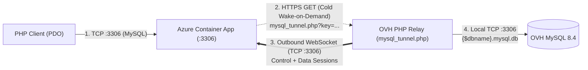

# MySQL Reverse WebSocket Tunnel on Azure

This repository provides a one-click deployment for a **TCP-over-WebSocket relay on Azure Container Apps (ACA)** with **scale-to-zero** support. It exposes a standard MySQL port (`3306`) accessible from any external PHP `PDO` client by encapsulating traffic over an outbound WebSocket tunnel initiated on demand by your shared hosting server (e.g., OVH).

It supports both **dynamic multi-database routing** (automatically routing `dbname=<db>` in your PDO DSN to `<db>.mysql.db` on MySQL 5.7 / 8.0 / 8.4) and **fixed-host transparent TCP bridging**.

---

## 1. One-Click Azure Deployment

Click the button below to deploy the Log Analytics Workspace, the Workload Profiles Environment, and the Azure Container App (`Microsoft.App` API `2026-01-01`):

[](https://portal.azure.com/#create/Microsoft.Template/uri/https%3A%2F%2Fraw.githubusercontent.com%2Fclysss%2FwsTunnelAzure%2Fmain%2Fazuredeploy.json)

### Deployment Parameters

Define the following values during deployment (keep `WAKE_KEY` and `TUNNEL_SECRET` handy for Step 2):

| Parameter | Description | Example |
| :--- | :--- | :--- |
| **App Name** | Unique name for the Azure Container App | `mysql-tunnel-relay` |
| **Location** | Azure deployment region (defaults to Resource Group location) | `francecentral` |
| **Wake Endpoint URL** | Full HTTPS URL where you will upload `mysql_tunnel.php` on OVH (without `?key=`) | `https://yourdomain.com/secure-bridge/mysql_tunnel.php` |
| **WAKE_KEY** | Secret key appended as `?key=...` when Azure wakes up OVH | `your-wake-secret-key` |
| **TUNNEL_SECRET** | Shared secret key validating the WebSocket connection | `your-long-tunnel-secret-key` |

Once the deployment completes, open **Deployment > Outputs** in the Azure Portal and copy the **`fqdn`** value (e.g., `mysql-tunnel-relay.xxxx.francecentral.azurecontainerapps.io`).

---

## 2. Server Setup (OVH / Shared Hosting)

1. **Upload the file:** Place `mysql_tunnel.php` in the exact subfolder on your OVH web space matching the **Wake Endpoint URL** you entered in Step 1 (e.g., `/www/secure-bridge/mysql_tunnel.php`).
2. **Check PHP version:** Ensure your `.ovhconfig` runs **PHP 8.1, 8.2, or 8.3** (PHP 7.x is not supported).
3. **Define the configuration parameters** at the top of `mysql_tunnel.php`:

| Parameter | What to define | Example |
| :--- | :--- | :--- |
| **`$WAKE_KEY`** | Must match the `WAKE_KEY` parameter defined in Step 1 | `'your-wake-secret-key'` |
| **`$TUNNEL_SECRET`** | Must match the `TUNNEL_SECRET` parameter defined in Step 1 | `'your-long-tunnel-secret-key'` |
| **`$AZURE_HOST`** | The `fqdn` output copied from Azure at the end of Step 1 (no `https://`, no `:3306`) | `'mysql-tunnel-relay.xxxx.francecentral.azurecontainerapps.io'` |
| **`$FIXED_DB_HOST`** | Leave empty (`''`) for **Dynamic Mode** (extracts `dbname` from PDO DSN and routes to `{$dbname}.mysql.db`). Set to a specific hostname (e.g., `'yourdb.mysql.db'`) for **Fixed Mode** (transparent TCP bridge). | `''` |
| **`$DEBUG`** | Set to `true` to log hex packet traces to `tunnel_debug.log` in the same folder; keep `false` in production. | `false` |

> **Important:** Because `mysql_tunnel.php` stays resident in memory for up to `290` seconds (`$MAX_RUNTIME`) using an exclusive file lock (`/tmp/ovh_mysql_tunnel.lock`), any edit to `mysql_tunnel.php` (such as toggling `$DEBUG` or `$FIXED_DB_HOST`) only takes effect once the current worker exits—or immediately if you click **Restart revision** under **Application > Revision and replicas** in the Azure Portal.

---

## 3. Updating Secrets & Configuration Post-Deployment

In Azure Container Apps, secrets (`WAKE_KEY`, `TUNNEL_SECRET`) and environment variables (`WAKE_URL`) are managed in separate panels and require a revision restart or a new revision to take effect.

### Updating `WAKE_KEY` or `TUNNEL_SECRET` (App Secrets)

1. Open your Container App in the Azure Portal and go to **Settings > Secrets** (or **Application > Secrets**).
2. Click the secret you want to rotate (`wake-key` or `tunnel-secret`), or click `...` > **Edit**, enter the new value, and click **Save**.
3. Go to **Application > Revision and replicas**, open the active revision details, and click **Restart revision** so running containers pick up the updated secret value.
4. Update `$WAKE_KEY` or `$TUNNEL_SECRET` at the top of `mysql_tunnel.php` on OVH to match.

### Updating `WAKE_URL` (Revision Environment Variables)

Existing revisions in Azure Container Apps are immutable; changing `WAKE_URL` (e.g., if you move `mysql_tunnel.php` to a different folder on OVH) creates a new revision:

1. Go to **Application > Revision and replicas** and click **Create new revision**.
2. Under the **Container** section, click the container name (`mysql-tunnel-relay`) and open the **Environment variables** tab.
3. Update the value of **`WAKE_URL`** (without `?key=...`), click **Save**, then click **Create** at the bottom of the page.
4. Wait until the new revision shows **Active** with **100%** traffic.

---

## 4. Architecture

A single multiplexed TCP ingress on port `3306` handles both incoming `PDO` MySQL clients and outbound WebSocket control/data sessions initiated by your OVH server. When idle for 5 minutes (`cooldownPeriod: 300`), the Azure Container App automatically scales down to `0` replicas.



```text
  [PHP Client (PDO)]
          │
          │  (1) TCP :3306 (MySQL protocol)
          ▼
  ┌──────────────────────────────────────────────────────┐
  │           Azure Container App (:3306)                │
  │         Multiplexed TCP / WebSocket Relay            │
  └───┬──────────────────────────────────────────────▲───┘
      │                                              │
      │ (2) HTTPS GET (Cold Wake-on-Demand)          │ (3) Outbound WebSocket
      │     .../mysql_tunnel.php?key=...             │     over TCP :3306
      ▼                                              │
  ┌──────────────────────────────────────────────────┴───┐
  │             OVH PHP Relay (mysql_tunnel.php)         │
  │      Dynamic Handshake Router ({$dbname}.mysql.db)   │
  └───┬──────────────────────────────────────────────────┘
      │
      │  (4) TCP :3306 (Internal OVH network)
      ▼
  [OVH MySQL 8.4]
```

### How Dynamic Routing Works (`$FIXED_DB_HOST = ''`)

In the MySQL protocol, the server speaks first (`seqId = 0`) before the client reveals which database (`dbname`) it wants to access. To route dynamically to `{$dbname}.mysql.db` without storing database credentials on OVH:

1. **Synthetic Greeting (`seqId = 0`):** Upon receiving `OPEN_DB` from Azure, `mysql_tunnel.php` sends a synthetic MySQL Protocol v10 greeting to the `PDO` client.
2. **Database Extraction (`seqId = 1`):** `PDO` replies with its `HandshakeResponse41` containing `dbname`. The relay validates `dbname` (`^[a-zA-Z0-9_-]+$`) and opens a TCP socket to `{$dbname}.mysql.db:3306`.
3. **Cryptographic Salt Switch (`seqId = 2` & `3`):** `mysql_tunnel.php` reads the real OVH MySQL greeting (`seqId = 0`), extracts its authentication plugin and 20-byte salt, and sends an `AuthSwitchRequest` (`0xFE`, `seqId = 2`) to `PDO`. `PDO` re-hashes the password against OVH's real salt (`seqId = 3`).
4. **In-Place Hash Patch (`seqId = 1` -> `seqId = 4`):** `mysql_tunnel.php` patches the 20-byte hash directly inside `PDO`'s original `HandshakeResponse41` (preserving all MySQL 8.4 capability flags and connection attributes), forwards it to OVH (`seqId = 1`), rewrites OVH's `OK` packet sequence ID from `2` to `4`, and switches to transparent bidirectional bridging.

---

## 5. Testing & Troubleshooting

### 1. Test the OVH Wake Endpoint

Verify that `mysql_tunnel.php` responds properly to the wake trigger:

```bash
curl -i "[https://yourdomain.com/secure-bridge/mysql_tunnel.php?key=YOUR_WAKE_KEY](https://yourdomain.com/secure-bridge/mysql_tunnel.php?key=YOUR_WAKE_KEY)"
```

- **Expected output:** `HTTP/1.1 200 OK` with body `OK` (calling it without a valid key returns `403 Forbidden`).

### 2. Test the Azure Relay Port (`3306`)

From your client machine, verify that port `3306` is reachable on your Azure Container App FQDN (probing `3306` automatically wakes the container if it is scaled to `0`):

```bash
nc -zv mysql-tunnel-relay.xxxx.francecentral.azurecontainerapps.io 3306
```

- **Expected output:** `Connection to ... 3306 port [tcp/mysql] succeeded!`

### 3. Test the End-to-End PDO Connection

Run a one-line PHP check to trigger a cold wake-up and query your OVH database:

```bash
php -r '$pdo = new PDO(
    "mysql:host=mysql-tunnel-relay.xxxx.francecentral.azurecontainerapps.io;port=3306;dbname=YOUR_DB_NAME;charset=utf8mb4",
    "YOUR_OVH_DB_USER",
    "YOUR_OVH_DB_PASSWORD",
    [PDO::ATTR_TIMEOUT => 30]
);
echo "Connected! MySQL version: " . $pdo->query("SELECT VERSION()")->fetchColumn() . PHP_EOL;'
```

- **Expected output:** After a ~15–20s cold-start delay (when scaled to `0` on ACA Consumption) or ~0.1–0.3s (when warm), prints `Connected! MySQL version: 8.4.x`. Subsequent queries execute immediately while the tunnel remains active.

### Common Issues

| Symptom | Cause & Resolution |
| :--- | :--- |
| **Connection hangs or times out on cold start** (`SQLSTATE[HY000] [2002]`) | ACA Consumption cold starts can take ~15–20s. Ensure `PDO::ATTR_TIMEOUT` is set to at least **`30`** seconds in your PHP client, and verify that `$AZURE_HOST` matches the exact `fqdn` from Azure with `$TUNNEL_SECRET` matching on both sides. |
| **Inspecting handshake failures** | Set `$DEBUG = true;` at the top of `mysql_tunnel.php`, click **Restart revision** in the Azure Portal, trigger a connection, and inspect `tunnel_debug.log` next to `mysql_tunnel.php`. Remember to set `$DEBUG = false;` and delete `tunnel_debug.log` afterward. |
| **Changes to `mysql_tunnel.php` not taking effect** | The previous PHP worker is still alive (up to `290` seconds). Go to **Application > Revision and replicas** in the Azure Portal and click **Restart revision** to force an immediate reconnect. |
| **OVH `500 Internal Server Error` on wake** | Check `.ovhconfig` and set `app.engine.version=8.2` (or `8.3`). |
| **`MaxNumberOfRegionalEnvironmentsInSubExceeded`** | Free/Student Azure subscriptions allow only 1 Container Apps Environment per region. Wait until the previous environment deletion completes before redeploying in the same region. |

---

## 6. Client Project Integration Sheet

Copy and paste the block below into the `README.md` (or `SETUP_DB.md`) of any consumer project using this MySQL tunnel, then fill in the `<...>` placeholders.

~~~markdown
## Database Configuration (Azure / OVH MySQL Tunnel)

This project connects to the OVH-hosted MySQL database through the [`clysss/wsTunnelAzure`](https://github.com/clysss/wsTunnelAzure) TCP-over-WebSocket relay deployed on **Azure Container Apps** (scale-to-zero enabled).

### 1. Relay Setup (if not already deployed)
1. **Azure Side:**
   - Deploy `azuredeploy.json` in `francecentral` using the *Deploy to Azure* button on [clysss/wsTunnelAzure](https://github.com/clysss/wsTunnelAzure) with:
     - **App Name:** `<mysql-tunnel-relay>`
     - **Wake Endpoint URL:** `<https://yourdomain.com/secure-bridge/mysql_tunnel.php>`
     - **WAKE_KEY:** `<YOUR_WAKE_KEY>`
     - **TUNNEL_SECRET:** `<YOUR_TUNNEL_SECRET>`
   - Copy the `fqdn` value from **Deployment > Outputs** in the Azure Portal.
2. **OVH Side:**
   - Upload `mysql_tunnel.php` (from [github.com/clysss/wsTunnelAzure](https://github.com/clysss/wsTunnelAzure)) into a non-obvious web subfolder (e.g., `/www/secure-bridge/mysql_tunnel.php`) with PHP 8.2+ enabled in `.ovhconfig`.
   - Set `$WAKE_KEY`, `$TUNNEL_SECRET`, and `$AZURE_HOST` (the Azure `fqdn`) inside `mysql_tunnel.php`. Leave `$FIXED_DB_HOST = ''` to route dynamically to `<OVH_DATABASE_NAME>.mysql.db` based on the PDO `dbname`.

### 2. PHP PDO Connection Example

Use the following configuration in your project to connect via `PDO` (fill in the `<...>` placeholders):

```php
<?php

$dbHost = '<mysql-tunnel-relay.xxxx.francecentral.azurecontainerapps.io>';
$dbPort = 3306;
$dbName = '<OVH_DATABASE_NAME>';
$dbUser = '<OVH_MYSQL_USER>';
$dbPass = '<OVH_MYSQL_PASSWORD>';

$dsn = sprintf(
    'mysql:host=%s;port=%d;dbname=%s;charset=utf8mb4',
    $dbHost,
    $dbPort,
    $dbName
);

$pdo = new PDO($dsn, $dbUser, $dbPass, [
    PDO::ATTR_ERRMODE            => PDO::ERRMODE_EXCEPTION,
    PDO::ATTR_DEFAULT_FETCH_MODE => PDO::FETCH_ASSOC,
    PDO::ATTR_EMULATE_PREPARES   => false,
    PDO::ATTR_TIMEOUT            => 30, // Allow enough time for ACA cold wake-up (~15-20s)
]);
```

> **Note:** The first query after 5 minutes of inactivity may take 15 to 20 seconds while the Azure container and the OVH WebSocket bridge wake up on demand. Keep `PDO::ATTR_TIMEOUT` set to at least `30` seconds.
~~~
